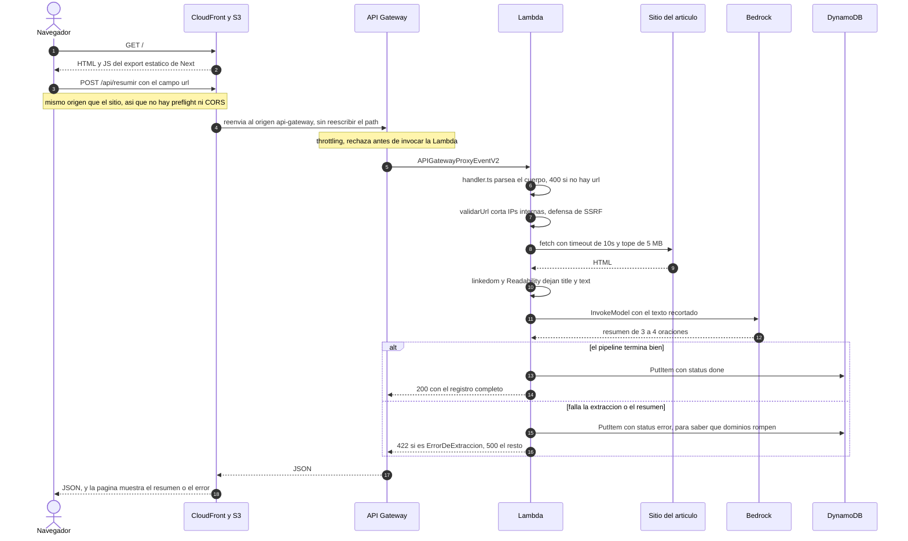

# Resumidor de articulos con IA

Pegas la URL de un articulo y te devuelve un resumen de 3-4 oraciones generado
con Claude en AWS Bedrock.

## Estado

**Fase 3 cerrada: el sistema completo esta en linea.** Frontend en Next.js
servido por CloudFront sobre un bucket privado de S3, contra la API de la fase
2. Todo -backend y frontend- vive en un unico stack, `resumidor`.

Se desplego **dos veces a proposito**: primero entero a mano desde la consola,
para ver que esconden las abstracciones de SAM, y despues con el template. El
despliegue manual encontro tres bugs reales en `template.yaml` que no se veian
leyendo el YAML (ver "Desplegarlo a mano: que mostro"). Los recursos creados a
mano ya se borraron.

- [x] Fase 1 - Pipeline: extraccion -> resumen -> persistencia
- [x] Fase 2 - Deploy a AWS
  - [x] Desplegado a mano por consola y verificado de punta a punta
  - [x] `template.yaml` corregido y desplegado con SAM
  - [x] Recursos manuales borrados
- [x] Fase 3 - Frontend en Next.js
  - [x] Export estatico servido desde S3 + CloudFront con Origin Access Control
  - [x] CORS acotado al dominio de CloudFront, resuelto por CloudFormation

## Arquitectura

### Que habla con que

```
Navegador
    |
    v
CloudFront  --(OAC, SigV4)-->  S3 (bucket privado, export estatico de Next)
    |
    |  el JS de la pagina hace POST { url }
    v
API Gateway (HTTP API)
    |
    v
Lambda  --1--> fetch(url) --> linkedom --> Readability --> { title, text }
        --2--> Bedrock (Claude Haiku 4.5) --> resumen
        --3--> DynamoDB (put)
    |
    v
{ id, url, title, summary, createdAt, status }
```

### Flujo de una request



## Estructura

```
template.yaml            Infra completa: Lambda, HTTP API, DynamoDB, IAM,
                         S3 y CloudFront
backend/
  src/
    handler.ts           Entrada de Lambda. Solo HTTP: parseo, codigos, errores.
    pipeline.ts          El flujo completo, sin nada de HTTP.
    extract.ts           Validacion de URL + fetch + Readability.
    summarize.ts         Llamada a Bedrock.
    store.ts             Escritura en DynamoDB.
    config.ts            Variables de entorno en un solo lugar.
    types.ts             Forma del registro.
  scripts/
    local.ts             Corre el pipeline sin desplegar nada.
frontend/
  next.config.mjs        Export estatico (output: "export").
  app/
    page.tsx             La pagina entera: formulario, estados, errores.
    layout.tsx           html y metadata.
    globals.css          Estilos, claro y oscuro.
```

`handler.ts` y `pipeline.ts` estan separados a proposito: el pipeline no sabe
que existe HTTP, y por eso el script local puede ejercitar el sistema entero sin
levantar API Gateway.

## Correrlo local

```bash
cd backend
npm install
```

**Sin credenciales de AWS** (verifica fetch + Readability):

```bash
npm run local -- --solo-extraccion https://en.wikipedia.org/wiki/Serverless_computing
```

**Con credenciales de AWS** (agrega la llamada a Bedrock):

```bash
npm run local -- https://en.wikipedia.org/wiki/Serverless_computing
```

Sin `TABLE_NAME` en el entorno, el paso de DynamoDB se saltea y avisa. Asi se
puede probar el resumen sin crear la tabla.

**El frontend con `npm run dev` no puede llamar a la API desplegada.** El
`AllowOrigins` de la API lista unicamente el dominio de CloudFront, asi que el
navegador bloquea la respuesta y la pagina muestra "No se pudo contactar al
servidor" sin mas detalle -un fallo de CORS es indistinguible de uno de red
desde JavaScript. Es esperado, no un bug. Para recuperarlo habria que agregar
`http://localhost:3000` a `AllowOrigins` en el template.

## Construir el artefacto

```bash
cd backend
npm run build
```

Deja `dist/handler.js`, un unico archivo de ~2,8 MB.

Para subirlo a mano por la consola de Lambda hay que comprimirlo, con el archivo
en la **raiz** del zip:

```powershell
Compress-Archive -Path dist\handler.js -DestinationPath dist\handler.zip -Force
```

Ese paso es solo para el despliegue manual; `sam build` empaqueta por su cuenta.

## Desplegar

Son dos pasos y ninguno se puede saltear: `sam deploy` crea la infraestructura
pero **no sube el frontend**, porque los archivos del sitio no son parte del
template.

```bash
# 1. backend + infraestructura
sam build
sam deploy

# 2. frontend
cd frontend
npm run build
aws s3 sync out/ s3://<NombreBucketSitio>
```

`sam deploy` imprime los Outputs, y de ahi salen los dos valores que hacen falta:
`NombreBucketSitio` para el sync y `UrlSitio` para abrir el resultado. El bucket
no tiene nombre fijo -CloudFormation lo genera- justamente porque los nombres de
bucket son unicos en todo AWS.

**`sam deploy` no lee `template.yaml`.** Lee `.aws-sam/build/template.yaml`, que
produce `sam build`. Si editas el template y desplegas sin reconstruir, SAM
despliega la version vieja y responde "No changes to deploy" sin avisar que el
build esta desactualizado.

**Al cambiar el frontend hace falta invalidar la cache.** CloudFront sigue
sirviendo la version anterior hasta que expire el TTL, aunque el objeto en S3 ya
sea otro:

```bash
aws cloudfront create-invalidation --distribution-id <id> --paths "/*"
```

Las primeras 1000 rutas por mes son gratis. Es el paso que se olvida y que hace
creer que el despliegue no funciono.

## Prerrequisitos de cuenta

`template.yaml` describe recursos, pero hay estado en la cuenta de AWS que **no
es un recurso** y que ningun despliegue crea. Clonar el repo y correr
`sam deploy` en una cuenta nueva produce un stack que despliega bien y falla en
runtime.

- **Suscripcion al modelo.** La primera invocacion de un modelo de terceros
  dispara por detras una suscripcion de AWS Marketplace, que requiere
  `aws-marketplace:Subscribe`. El rol de ejecucion de la Lambda no tiene ese
  permiso, ni deberia tenerlo. Hay que invocar el modelo **una vez desde el
  Playground de Bedrock con un usuario admin**; despues la Lambda invoca sin
  necesitarlo nunca mas. Es una vez por cuenta.
- **Region.** Bedrock es regional, y Haiku 4.5 se sirve por un inference profile
  cross-region que enruta a us-east-1, us-east-2 y us-west-2. Los permisos IAM
  tienen que cubrir las tres regiones destino (`arn:aws:bedrock:*::...`), no
  solo la del stack, o el resultado son fallos intermitentes.
- **Cuentas nuevas.** Traen una verificacion inicial que bloquea Bedrock por un
  rato, y cuotas reducidas: el limite de concurrencia de Lambda arranca cerca de
  10 en vez de 1000, lo que ademas impide fijar `ReservedConcurrentExecutions`
  (AWS exige dejar 100 unidades sin reservar).

## Decisiones

**Claude Haiku 4.5, no Claude 3 Haiku.** El criterio original era costo y
velocidad; Haiku 4.5 es el modelo actual que cumple ese criterio.

El ID del modelo depende del endpoint y **no son intercambiables**:

| Endpoint | ID |
|---|---|
| `bedrock-runtime` (el que usamos) | `us.anthropic.claude-haiku-4-5-20251001-v1:0` |
| `bedrock-mantle` | `anthropic.claude-haiku-4-5` |

En el endpoint clasico el ID viaja **en la URL** (`/model/{id}/invoke`), asi que
un ID de la otra familia no da un error de validacion: da `not_found_error`. El
prefijo `us.` es el inference profile cross-region, que es la unica forma en que
se sirve Haiku 4.5.

**`@anthropic-ai/bedrock-sdk` en vez de `@aws-sdk/client-bedrock-runtime`.** Da
`messages.create()` con tipos de TypeScript en vez de armar el JSON del body a
mano. Esto sigue en pie.

**`AnthropicBedrock` en vez de `AnthropicBedrockMantle` (decision revertida).**
La eleccion original era Mantle, el endpoint de Bedrock que habla la Messages
API de forma nativa. No funciono: en una cuenta de AWS recien creada, Mantle
reconoce el modelo pero responde `permission_error` con
`"is not available for this account"` y una invitacion a contactar a AWS Sales.
Se descubrio al desplegar, no antes.

El cambio fueron dos lineas, porque los dos clientes salen del mismo paquete y
exponen la misma superficie. Eso corrige de paso la justificacion original: el
ahorro de no armar el JSON a mano lo daba el paquete, no Mantle. La diferencia
real entre los dos endpoints es el protocolo del cable y que tan rapido llegan
las capacidades nuevas, no la ergonomia del codigo.

Si Mantle se habilita mas adelante, volver son esas mismas dos lineas mas el
cambio de ID y de permisos IAM (`bedrock-mantle:CreateInference` sobre
`arn:aws:bedrock-mantle:REGION:CUENTA:project/default`).

**Export estatico sobre S3 + CloudFront, no Amplify ni Vercel.** El frontend no
necesita servidor: es un formulario que hace `fetch` a la API. Con
`output: "export"`, `next build` deja HTML, CSS y JS sueltos que S3 sirve sin
ejecutar nada.

Se descarto Amplify Hosting porque esconde el S3 y el CloudFront que hay debajo
-que es justo lo que este proyecto queria destapar-, y Vercel porque sacaria el
frontend de AWS.

El bucket queda **completamente privado**: los cuatro bloqueos de acceso publico
activos y ninguna configuracion de sitio web estatico. CloudFront lo lee con un
Origin Access Control, que firma cada request con SigV4. Pedirle un objeto
directo a S3 devuelve 403; el mismo objeto por CloudFront devuelve 200. Es la
diferencia entre "un bucket abierto a internet" y "un origen privado detras de
un CDN".

**Es la razon por la que CloudFront esta en el mismo stack que la API.** El
`AllowOrigins` del CORS no contiene un dominio sino una referencia,
`!Sub "https://${DistribucionSitio.DomainName}"`. CloudFormation lo resuelve al
desplegar, asi que si la distribucion se recrea, el CORS se actualiza con ella
en el mismo deploy y no pueden quedar desincronizados. El costo es que ahora
todos los deploys esperan a CloudFront, aunque solo se haya tocado la Lambda.

**linkedom en vez de jsdom.** jsdom evalua
`require.resolve("./xhr-sync-worker.js")` al cargar el modulo, para poder lanzar
un proceso hijo si alguien usa XHR sincrono. Un bundler borra la estructura de
archivos en disco, el resolve falla, y la Lambda muere en el arranque con
`Runtime.ImportModuleError` antes de ejecutar una linea propia. Se puede
parchear empaquetando ese worker por separado, pero en SAM eso obliga a
`BuildMethod: makefile`, que agrega un requisito de `make` y deja hardcodeada
una ruta a las tripas internas de jsdom.

linkedom no lanza procesos hijos, asi que el problema desaparece de raiz. El
bundle paso de 8,3 MB a 2,8 MB y `BuildMethod: esbuild` vuelve a alcanzar. De
paso resuelve el pendiente de peso que venia de la fase 1.

El costo fue reverificar la extraccion, porque es otra implementacion de DOM. Se
probo contra Wikipedia en ingles y espanol, un blog moderno con mucho JS, un
articulo largo de HTML plano y un sitio de documentacion: titulo y texto
correctos en los cinco. Un detalle de la migracion: linkedom no recibe una URL
base como jsdom, asi que `extract.ts` le define `baseURI` y `documentURI` a mano
para que Readability resuelva los enlaces relativos.

**Validacion de URL antes del fetch.** La Lambda busca una URL que eligio un
desconocido. Sin filtro, cualquiera puede pedirle que pegue contra
`169.254.169.254` (metadatos de EC2) o contra IPs privadas y le devuelva el
contenido: eso es SSRF. `extract.ts` bloquea el literal del host. Queda
pendiente el caso de un dominio publico que resuelve a IP privada (DNS
rebinding), que exige validar la IP resuelta antes de conectar.

**Los errores tambien se guardan.** Un registro con `status: "error"` deja
rastro de que dominios rompen la extraccion. Sin eso, los fallos son invisibles.

## Sincrono vs asincrono

El campo `status` admite `pending`, pero **hoy ese valor es inalcanzable**: el
flujo es sincrono, escribimos el registro una sola vez y ya con el resultado
final. Nadie lee nunca un `pending`.

Eso no quiere decir que el campo sobre. Quiere decir que el modelo de datos esta
describiendo una arquitectura que todavia no construimos. El limite real: API
Gateway corta a los 30 segundos, y `fetch` + linkedom + Bedrock encadenados pueden
acercarse en un articulo largo o un sitio lento.

La version asincrona seria: la Lambda valida, escribe `pending`, encola el
trabajo y responde 202 con el `id`; un worker procesa y actualiza a `done`; el
frontend consulta por `id`. Es mas robusto y mas caro en complejidad. Decision
para la fase 2 o 3, cuando haya numeros de latencia reales para justificarla.

## Pendientes conocidos

`template.yaml` ya tiene aplicadas todas las diferencias que encontro el
despliegue manual: el ID del modelo, los dos ARNs de Bedrock, `dynamodb:PutItem`
explicito en vez de `DynamoDBCrudPolicy`, la API declarada explicitamente con
`CorsConfiguration` y `RouteSettings`, y el build simplificado tras el cambio a
linkedom. Se comparo el rol IAM generado por CloudFormation contra el escrito a
mano: trust policy identica y los ARNs de Bedrock iguales byte por byte.

Lo que queda abierto:

- **`ReservedConcurrentExecutions` esta como comentario, no como propiedad.**
  Junto con el throttling son los unicos limites duros reales contra un gasto
  descontrolado: los budgets de AWS solo avisan, y con varias horas de retraso.
  Hoy ponerlo haria fallar el deploy, porque AWS exige dejar 100 unidades de
  concurrencia sin reservar y una cuenta nueva tiene cerca de 10 en total.
- **La memoria de la Lambda (1024 MB) quedo dimensionada para jsdom.** Con
  linkedom hay margen para bajarla, pero en Lambda la CPU escala con la memoria,
  asi que bajarla puede alargar el parseo y no ahorrar nada. Hay que medir, no
  estimar.
- **El log group de la Lambda no tiene retencion.** El default de todo log group
  de Lambda es "nunca expira", asi que los logs se acumulan para siempre. Aca son
  kilobytes y da igual, pero es el patron que hace que CloudWatch Logs termine
  siendo una parte no trivial de la factura en cuentas reales. Se arregla
  declarando un `AWS::Logs::LogGroup` con `RetentionInDays`, pero eso obliga a
  fijar tambien el `FunctionName`: hoy CloudFormation lo genera con sufijo
  aleatorio y el nombre del log group no se puede predecir.
- **El endpoint no tiene autenticacion.** El CORS ya esta acotado al dominio de
  CloudFront, pero eso solo frena el uso desde otra pagina web: CORS lo aplica el
  navegador, asi que `curl` o cualquier script lo ignoran por completo. Contra
  abuso programatico lo unico que protege hoy es el throttling de 5 req/s y la
  cuota baja de concurrencia de la cuenta. Si algun dia importa, la opcion es un
  JWT authorizer con Cognito.
- **El sync a S3 no esta automatizado.** `sam deploy` no sube el frontend, y el
  `aws s3 sync` mas la invalidacion son pasos manuales documentados en
  "Desplegar" pero no scripteados. Un `npm run deploy` que lea los Outputs del
  stack lo cerraria.
- Sin tests automatizados todavia.

## Desplegarlo a mano: que mostro

Se creo todo por consola antes de tocar SAM, a proposito. Encontro los tres
bugs de arriba, y dejo dos cosas claras que no se ven leyendo el YAML.

**Recursos que existen y que nadie creo explicitamente.** Son los que hay que
acordarse de borrar:

| Recurso | Quien lo creo |
|---|---|
| Log group `/aws/lambda/resumidor-manual` | La propia Lambda, con los permisos de `AWSLambdaBasicExecutionRole` |
| Resource-based policy en la Lambda | La consola, al conectar la integracion con API Gateway |
| Stage `$default` de la HTTP API | El asistente de creacion de la API |

Esa resource-based policy es una tercera clase de documento IAM, distinta de las
dos habituales: el *trust policy* dice quien puede asumir un rol, la
*permissions policy* dice que puede hacer quien lo asumio, y esta vive pegada al
**recurso** y dice quien puede invocarlo desde afuera. En el template la genera
`Events: Type: HttpApi` sin que aparezca en ningun lado.

**Ninguno de los dos caminos es "el que ensena".** La consola muestra lo que la
abstraccion esconde: `DynamoDBCrudPolicy` son diez acciones sobre dos recursos,
y `Type: HttpApi` genera cuatro recursos ademas de la API. Pero el template
llega a superficie que la UI ni siquiera expone: el throttling de una HTTP API
no tiene pantalla, solo CLI o `RouteSettings`.

## Borrar lo desplegado a mano

Ya ejecutado. Queda como registro del procedimiento, en orden inverso a la
creacion porque las dependencias lo exigen:

1. API Gateway -> `resumidor-manual-api` -> Delete
2. Lambda -> `resumidor-manual` -> Delete
3. CloudWatch -> Log groups -> `/aws/lambda/resumidor-manual` -> Delete
   (**no** se borra junto con la funcion)
4. IAM -> Roles -> `resumidor-manual-lambda-rol` -> Delete
5. DynamoDB -> `resumidor-manual-resumenes` -> Delete

Cinco pasos, uno de ellos facil de olvidar. Con el stack desplegado el
equivalente es `sam delete`, y esa diferencia importa mas de lo que parece: la
proteccion mas efectiva contra gastar de mas es borrar lo que no se esta usando,
y eso solo se cumple si borrar es barato.

La suscripcion al modelo en Bedrock no se borra ni hace falta: no cuesta nada y
es estado de cuenta, no un recurso.
